# craft3d

**Two Claude Code commands for building accurate 3D models in three.js from code: `/3d-model` draws them as realistic shaded metal, `/wireframe` draws them as technical illustrations.** Give either one a photo, a drawing, a product, a spec, or just an idea. It builds the object at real dimensions, with every moving part driven by real kinematics: IK, slider-cranks, gear trains, linkages, cams. Then it **measures and photographs its own work** before calling it done, and exports **one HTML file** that opens offline.

Both commands share one engine, so every model has a button that switches between the two looks.

| `/3d-model`: realistic | `/wireframe`: technical drawing |
|---|---|
| 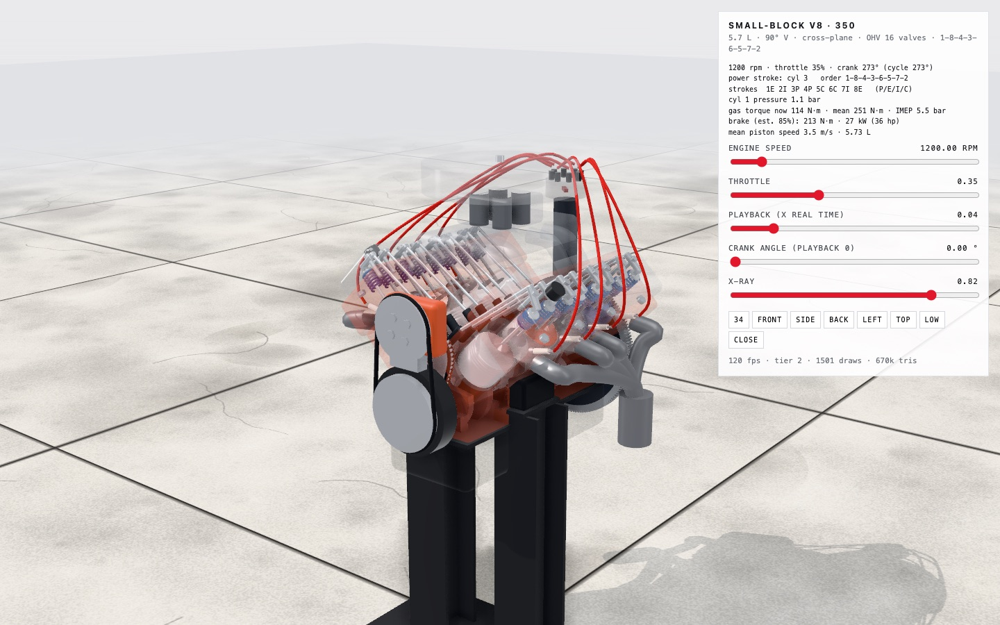 | 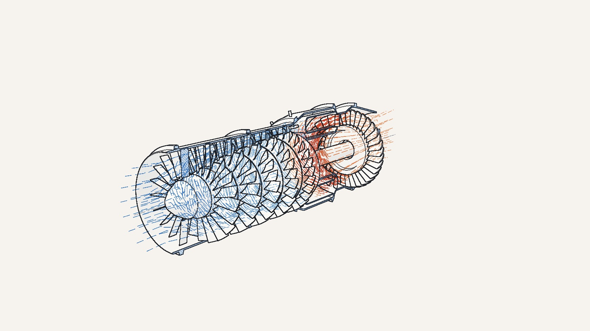 |
| Shaded paint, metal, glass and rubber, clean or worn and battle-damaged, in a studio or outdoors. | Ink outlines with hidden lines removed, section cuts with hatched faces, centre lines, phantom casings, flow lines and exploded views. |

## Which command?

| You want | Use |
|---|---|
| A game or website asset, a product render, a realistic machine, worn or damaged metal | `/3d-model` |
| A cutaway, a cross-section, an exploded view, a blueprint, a "how it works" illustration, line art | `/wireframe` |
| Both | Either one: the viewer's **drawing / realistic** button (or the `L` key) switches looks on any model |

Motion is part of both. If the thing moves, it moves by its real equations in either look.

---

## Why it's accurate

Most AI-generated 3D comes out generic because it's built from a vague picture of the thing. craft3d makes Claude work like an engineer:

1. **Evidence first.** It uses your reference image or real specs, and measures the image in pixels against a known size.
2. **A dimension sheet in millimetres.** Every number is written down with where it came from.
3. **Real joints.** Every moving part pivots where the real joint is.
4. **Motion from equations, not keyframes.** It uses IK, linkages and no-slip ground contact, so the pose, the numbers and the motion always agree.
5. **Parts built the way they're manufactured.** Plate is cut and chamfered, castings are rounded, shafts are turned, structure is beams. Nothing has a razor edge.
6. **Realistic wear.** Chipped edges, rust under the chips, streaks, grime, soot and impact dents all sit where real wear happens.
7. **Proof.** Automatic checks catch floating parts, cylinders mounted on nothing, rods pulling out of their barrels and feet that slide. Then it takes screenshots from every side and compares them with the reference.

The checks find real mistakes. While the skill was being built, they caught a hydraulic cylinder pinned 70 mm from any metal:

| Before: the cylinder base floats in front of the post | After: a mounting bracket, check passes |
|---|---|
| 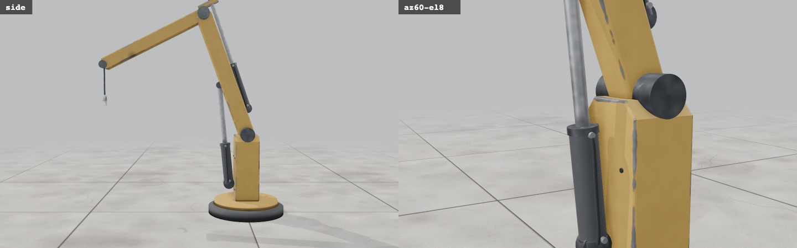 | 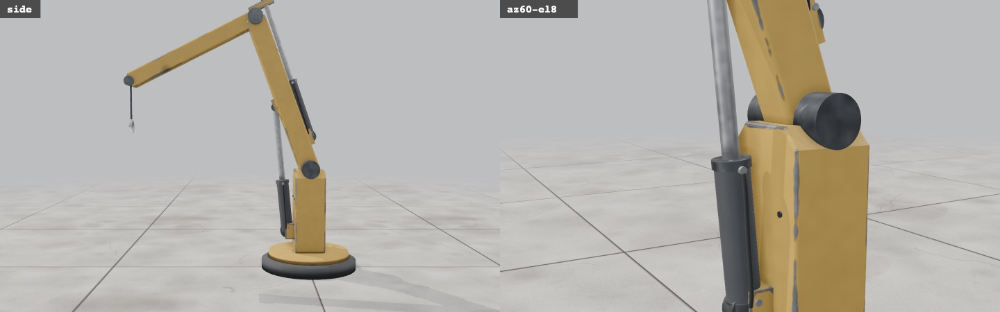 |

## The examples

**Try them now:** the [`demos/`](demos) folder holds a ready-built, single-file HTML of each example: [`turbojet.html`](demos/turbojet.html), [`v8-engine.html`](demos/v8-engine.html), [`mechanisms.html`](demos/mechanisms.html) and [`crane.html`](demos/crane.html). Download one and double-click it. It runs offline, with no install. (GitHub shows HTML as source code, so open the file locally.) Every demo has the **drawing / realistic** button.

Start your own project from the closest one: `node ~/.claude/craft3d/tools/new.mjs ./my-project --example turbojet` (`--example v8`, `--example mechanisms`, or leave it off for the crane).

| Example | What it is |
|---|---|
| `turbojet` | An axial turbojet, opening as a technical drawing: a 5-stage compressor, an annular combustor with 12 injectors, one turbine stage, a nozzle. The gas path is sized from its thermodynamics: the compressor hub rises stage by stage because continuity says it must as the air gets denser, and the turbine's work balances the compressor's. Flow lines are coloured by the gas temperature and move at the axial velocity. Section cut along the axis, exploded view, a spool speed slider. |
| `v8` | A running Chevrolet 350 small-block built from published dimensions, with these parts: <ul><li>a cross-plane crank, with 8 pistons and rods moved by the exact slider-crank equation</li><li>a 21:42 timing chain whose links move</li><li>the cam, 16 lobes, lifters, pushrods, 1.5:1 rockers, valves and springs</li><li>a distributor rotor that points at each cylinder's terminal as it fires</li><li>sparks 30° before top dead centre</li><li>each cylinder's charge coloured by its stroke</li><li>gas pressure, torque and power readouts</li><li>x-ray casings</li></ul> |
| `mechanisms` | One crank drives a module-5 gear train, a piston in a glass cylinder, a rack and pinion, and a Theo Jansen leg |
| `crane` (default) | A truck loader crane, the whole pattern in one short file: IK boom, two hydraulic cylinders, a hook that hangs plumb |

What the V8's self-test proves, all measured on the rendered model:

| Check | Result |
|---|---|
| Displacement | 349.8 cubic inches (a "350") |
| Piston below the deck at top dead centre | 0.025", the factory figure |
| Firing order, derived purely from the crank geometry | 1-8-4-3-6-5-7-2 |
| Rod length and wrist pin position | error 0 on every frame |
| Distributor rotor and cam lobe timing | 0.000° error |
| Closest valve-to-piston gap through the cycle | 2.68 mm, at overlap |
| Full-throttle average cylinder pressure; torque | 11 bar; about 425 N·m (315 lb-ft) at the crank |

| Valvetrain close-up | Mechanisms |
|---|---|
| 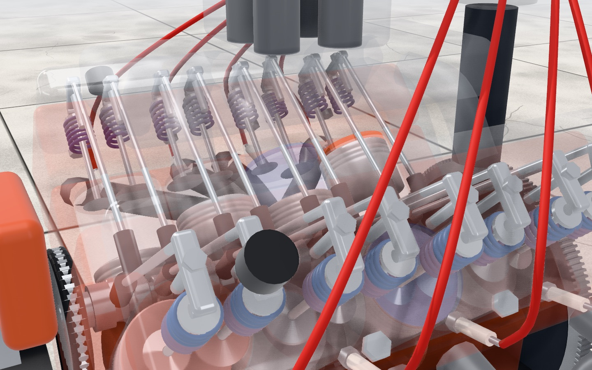 | 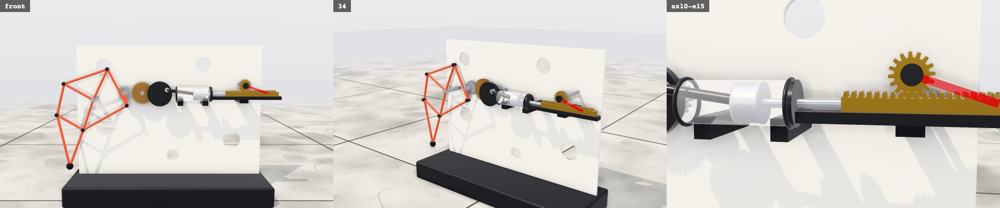 |

### The drawing look

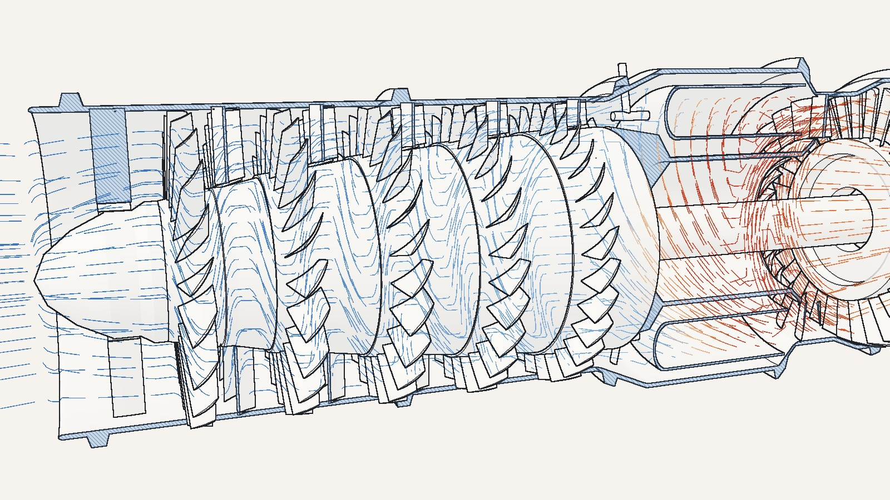
<sub>The turbojet's compressor and combustor in section. The casing and the stator rows are cut and hatched, the rotor is left whole, and the flow lines run blue to red as the gas heats up.</sub>

| Exploded view | Blueprint palette |
|---|---|
| 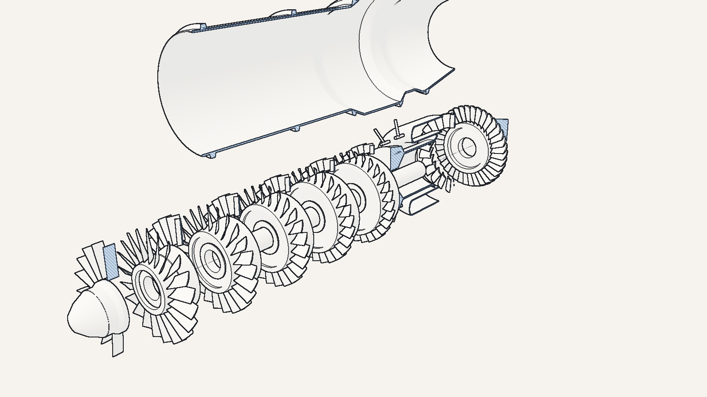 | 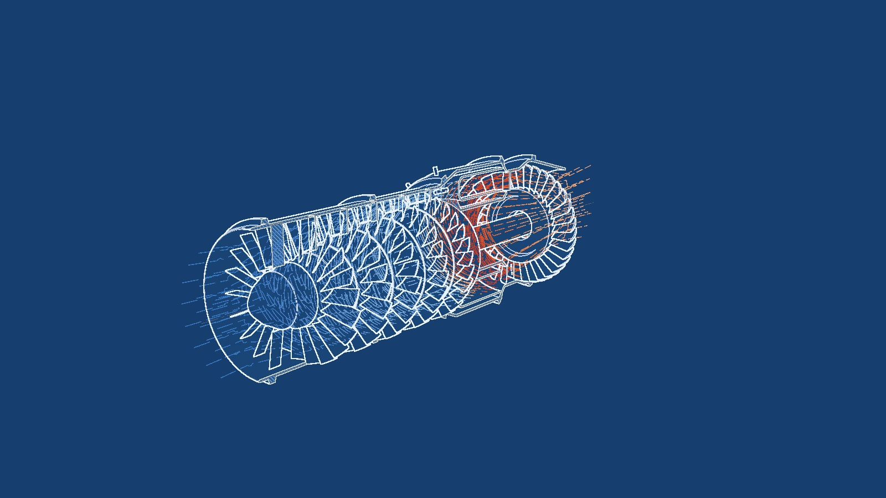 |
| **V8, cut through cylinders 1 and 2** | **Mechanisms, drawn** |
| 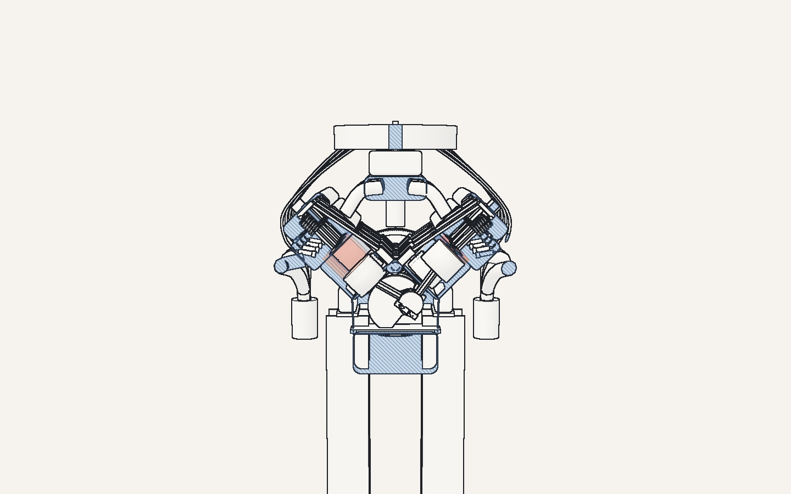 | 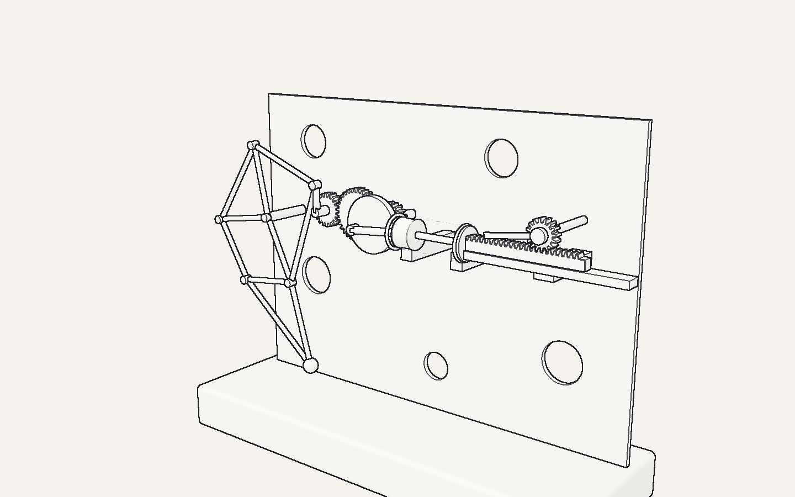 |

What the turbojet's self-test proves:

| Check | Result |
|---|---|
| Mass flow at every compressor station (continuity) | equal to 4×10⁻¹⁶ |
| Turbine work against compressor work, through the shaft efficiency | balanced to 2×10⁻¹⁶ |
| Compressor exit | 473 K, 456 kPa at pressure ratio 4.5 |
| Design speed, from a 350 m/s tip speed | 37,136 rpm |
| Nozzle | choked; jet 553 m/s |
| Static thrust | 2.2 kN from 3.75 kg/s (588 N·s/kg, typical of a simple turbojet) |
| Smallest gap between any built blade tip and the casing | 0.60 mm, the design clearance |

The probe caught a bug while the example was being built. Blades were placed by height rather than by true radius, so their edges reached 0.14 mm from the casing. The fix is now built into `blade()`.

---

## Install

Requirements: [Claude Code](https://claude.com/claude-code), Node.js 18+ and Git.

```bash
git clone https://github.com/yesith0106/craft3d.git ~/.claude/craft3d
cd ~/.claude/craft3d
npm run setup        # Playwright + Chromium for the check tool, then links the two commands into ~/.claude/skills
```

Restart Claude Code. You now have `/3d-model` and `/wireframe`. Claude also picks the right one by itself: ask for "a realistic …" and it uses `/3d-model`; ask for "a cutaway / section / exploded view / line drawing of …" and it uses `/wireframe`.

The commands are links into the repo, so `git -C ~/.claude/craft3d pull` updates both. To link them somewhere else, run `node tools/install.mjs --dir <skills folder>`.

---

## Using it

### 1. Recreate something real

Attach a reference image, or name the object:

> Recreate this excavator in three.js [image]. Make it accurate to the photo, with working boom, stick and bucket cylinders.

> /3d-model Build a CAT 320 excavator at real dimensions with a slider for each hydraulic joint.

> /wireframe A cutaway of a Rotax 912 aircraft engine, section through one cylinder, crank and cam left whole.

> Recreate this robot [image]. Keep the materials ultra realistic: metal and damaged metal.

> Build a full functional simulation of a V8 engine as an HTML file.

Claude collects the specs, measures your image (mm per pixel from a known size), lists every feature it sees, and builds view by view. It matches the camera to your photo for a side-by-side comparison. At the end it tells you what was matched from evidence, what was measured from the image, and what it had to infer.

### 2. Create something from an idea

> /3d-model Design a salvage mech for a desert scrapyard, about 3 m tall, diesel-hydraulic, old and patched up.

> /wireframe Design a hand-cranked water pump and show it as an exploded technical drawing on blueprint paper.

> Make a heavy cargo lifter for a sci-fi port: forklift-style mast, four legs, industrial white with red warning lights.

Claude writes a five-line brief (job, size, power, world, look) and borrows proportions from real machines that do the same job, such as excavator cylinders for a mech's legs or forklift masts for a lifter. It blocks out the masses at full size, then adds detail. It still has to pass the same checks, so the result reads as a machine someone could build.

### 3. Use it in your own project

Every model drops into any three.js app: a game, a website, a configurator. Ask for that directly:

> Take the model and put it in a third-person game where I can walk it around with WASD.

### Tips for better results

- **More views beat one perfect photo.** Front, side and back let it measure instead of guess.
- **Give a size if you know it** ("about 2.7 m tall", "a 20 ft container"). One real number sets the scale for everything.
- **Say what should move** ("boom, stick and bucket", "legs walk, arms swing"). That decides which joints get kinematics.
- **Ask to see the tests.** It saves labelled screenshots and the measured numbers, and can show you both.

---

## Doing it by hand

You don't need Claude to use the parts. Start a project:

```bash
node ~/.claude/craft3d/tools/new.mjs ./my-model
cd my-model
npm run dev          # open the URL it prints
```

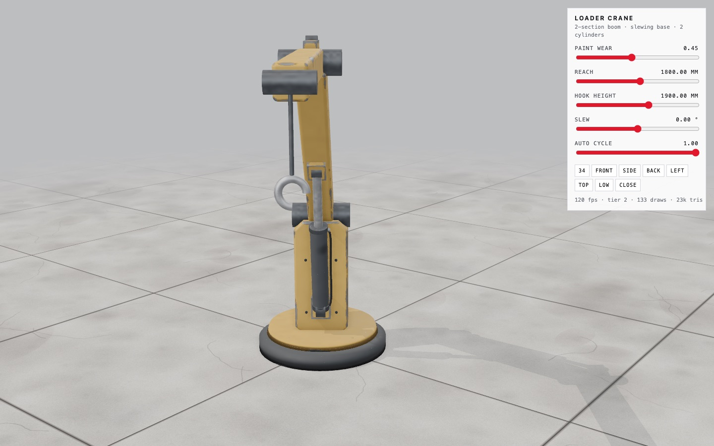

The viewer gives you:
- an orbit camera
- standard views: front, side, back, left, top, 3/4, low and close
- a **drawing / realistic** button (or `L`) to switch looks, and a section-cut slider in the drawing look
- a paint wear slider (keys `1` / `2` / `3` = factory / worn / battle)
- a slider for every input your model declares
- frame rate and draw call stats
- `H` to hide the panel

Add `?stage=outdoor` to the URL for sky, haze and sun. Add `?look=drawing` to open drawn, and `&palette=blueprint` (or `print`) to change the paper.

To share a model, run `npm run html`. It builds `dist/model.html`, one self-contained file that opens by double-clicking, with no server and no internet needed.

Edit `src/model/model.js`. The starter is a hydraulic loader crane that shows the whole pattern in one file. A model exports `info` and `build()`:

```js
export const info = {name: 'My machine', description: '...', stage: 'studio'};

export function build({stage, THREE}) {
  const root = new THREE.Group();
  root.scale.setScalar(0.001);          // build in millimetres, display in metres
  // ... parts, pivots, materials ...
  return {
    root,
    params: [{key: 'reach', min: 600, max: 2900, value: 1800, unit: 'mm'}],   // become sliders
    update(dt, t, p) { /* pose everything from p.reach */ },
    focus: [0.8, 1.2, 0.6], radius: 1.6,   // camera framing
    struts: struts.list,                   // lets the mount check test your cylinders
    probe() { return {/* numbers to verify */}; },
    section: {normal: [1, 0, 0], from: 0.2, to: 0, value: 1},   // optional: the drawing look's section cut
  };
}
```

Set `info.look: 'drawing'` to open in the drawing look. Tags on any object steer the drawing: `userData.noCut` (the section leaves it whole), `userData.ink = 'color'` (drawn in colour: gas, sparks), `'ghost'` (phantom lines), `userData.realOnly` / `inkOnly` (shown in one look only). See [`references/drawing.md`](references/drawing.md).

### The library (`src/craft/`)

| File | What's in it |
|---|---|
| `shapes.js` | `box`, rounded box `rb`, `cylX/Y/Z`, `slab`, `chamferBox`, `profile` (outlines with holes), `frameGeo`, `lathe`, `turned` (closed turned solids with crisp corners), `ibeam`, `tube`, `sweep`, `gear` (sized by real module, spur or helical), `rack`, `spring`, `blade` (twisted airfoils for compressors, turbines, fans, propellers), `tyre`, `ringText`, `boltHead`, `rock`, seeded `rng`, `outward`, `creased`, `setDetail('lo')` for a light build, and `kit()` |
| `ink.js` | The drawing look: `createInk(stage)` draws outlines, creases, hidden-line removal, section cuts with hatching, phantom lines and colour overlays. Also `PALETTES` (paper, blueprint, print), `inkLine` (fat, dashed, gradient lines), `centerline`, `ramp` (cold to hot colours) |
| `materials.js` | Clean finishes: clearcoat paints, gloss and satin black, steel, chrome, aluminium, brass, bronze, copper, ceramic, rubber, glass, and a flat low-detail variant |
| `wear.js` | `makeWorn({color, rough, painted, bare, seed, dent})` for worn paint or bare metal; `bakeRest(root)`; the global `WEAR.uDamage` (0 to 1) |
| `rig.js` | Motion helpers:<ul><li>`twoLinkIK`</li><li>`circles` (an exact linkage solver)</li><li>`sliderCrank`</li><li>`meshAngle` and `centreDistance` (meshing gears)</li><li>`rackTravel`</li><li>`aim` (a rod between two points)</li><li>`instancedLinks` (many links in one draw call)</li><li>`tabulate`</li><li>`lineArm`</li><li>`strideFor` (no-slip walking)</li><li>`makeStruts` (hydraulic cylinders with hoses)</li><li>`exploder` (exploded views)</li></ul> |
| `props.js` | Real-size props: 20 ft container, 200 l drum, jersey barrier, crate, 9 m light pole, broken wall, gantry crane, rubble, plus ground colliders and `collide()` |
| `stage.js` | `createStage({canvas, mode, env, floor})`: a soft-box or room studio, or an outdoor sky; a concrete or shadow-only floor; shadows that follow a target; ambient occlusion with a skip list; quality tiers |
| `textures.js` | Procedural concrete and ground variation |
| `checks.js` | `floatingParts`, `anchorGaps`, `overlaps` |

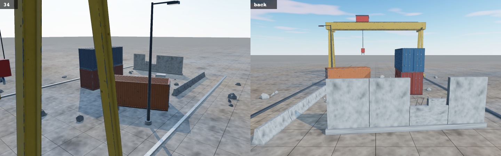
<sub>`?stage=outdoor` with the props library: containers, gantry crane, barriers, drums, light pole, broken wall, rubble.</sub>

### Testing a model

The page exposes `window.VIEW`, so the test tool can drive it:

```bash
node ~/.claude/craft3d/tools/shoot.mjs --project ./my-model --out ./shots --query hud=0 --plan '[
  {"sample": {"expr": "VIEW.check()", "frames": 1, "label": "check"}},
  {"views": ["front", "side", "back", "34", "close"]},
  {"damage": 0.92, "wait": 300, "shot": "battle"},
  {"eval": "VIEW.set(\"reach\", 2900)", "wait": 400, "sample": {"expr": "VIEW.probe()", "frames": 240, "label": "motion"}}
]'
```

It starts the dev server, runs the plan on your real GPU, and writes:
- every screenshot, plus `sheet.png` with all of them tiled and labelled
- one JSON file per `sample`
- a printout of the GPU, frame rate, draw calls and every console error

Plan steps:

| Step | Does |
|---|---|
| `{"views": ["front", {"az": 40, "el": 10, "d": 2}]}` | Sets each camera view and screenshots it |
| `{"shot": "name"}` | Takes a screenshot |
| `{"eval": "..."}` | Runs code in the page |
| `{"down": ["KeyW"]}` / `{"up": [...]}` | Holds or releases keys, for interactive builds |
| `{"wait": 800}` | Waits, in milliseconds |
| `{"damage": 0.92}` | Sets paint wear |
| `{"sample": {"expr": "VIEW.probe()", "frames": 120, "label": "x"}}` | Records a value every frame to JSON |
| `{"filmstrip": {"every": 250, "count": 8, "label": "cycle"}}` | Takes a frame every N ms and tiles them in time order with `t=` labels, to review motion without a video |

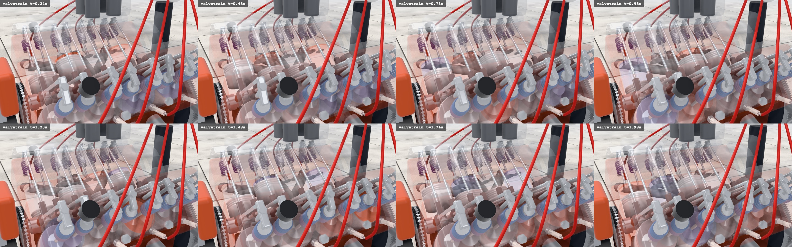
<sub>A filmstrip of the V8 valvetrain: pistons travel, valves open, and the charges change colour stroke by stroke.</sub>

A model passes when:
- `VIEW.check()` returns `{"floating": [], "anchors": []}` at rest and at the extremes of every input
- its own `probe()` invariants hold through the motion
- the screenshots match the reference

---

## What's inside the skill

```
skills/3d-model/SKILL.md the /3d-model command: realistic look
skills/wireframe/SKILL.md the /wireframe command: drawing look
METHOD.md                the method both commands follow (examples, library, model contract, review loop)
references/
  drawing.md             how the drawing look works, what a model needs for it, fixes
  recreate.md            matching a photo or a real object
  from-idea.md           designing from a brief
  accuracy.md            dimension sheets, kinematics, probes
  modeling.md            part trees, which shape for which part, detail rules
  materials.md           material values, the wear shader, lighting
  pitfalls.md            bugs that were hit, and their fixes
lib/                     the library (copied into each project as src/craft/)
template/                the viewer project
examples/                turbojet, v8, mechanisms (crane is the template's own model)
demos/                   each example built as one offline HTML file
tools/new.mjs            scaffold a project (--example)
tools/shoot.mjs          screenshots, filmstrips, measurements, contact sheets
tools/html.mjs           fold a build into one offline HTML file
tools/install.mjs        link the two commands into ~/.claude/skills
docs/                    images for this guide
```

## Troubleshooting

- **Blank page from `dist/index.html`.** That page needs a server (`npm run preview`). For double-clicking, use `npm run html` and open `dist/model.html`.
- **`shoot.mjs` can't find Chromium.** Run `npm run setup` in the skill folder, or set `CHROMIUM=/path/to/chrome`.
- **The tool warns "software renderer".** The headless browser didn't get your GPU, so frame rates aren't representative. Run it on a machine with a GPU or desktop session.
- **`/3d-model` or `/wireframe` doesn't appear.** Run `npm run link` in the repo and restart Claude Code. If a folder with that name already exists in `~/.claude/skills`, the installer leaves it alone and says so.
- **Stray lines or odd hatching in the drawing look.** See the table at the end of [`references/drawing.md`](references/drawing.md).
- **Low frame rate.** The viewer steps down automatically (no ambient occlusion, then lower resolution). Check the `draws` count, and merge static geometry if it's over about 500.

## License

MIT. See [LICENSE](LICENSE).
