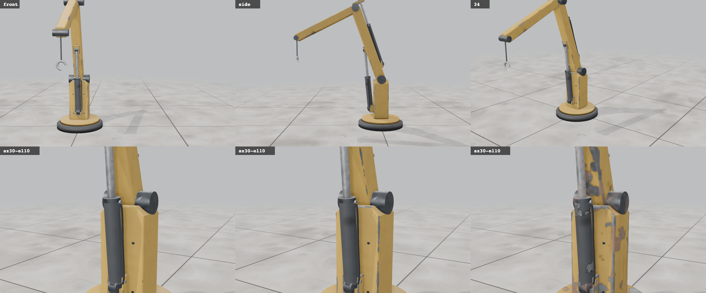
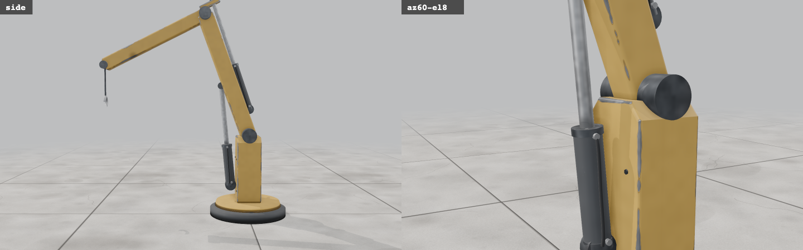
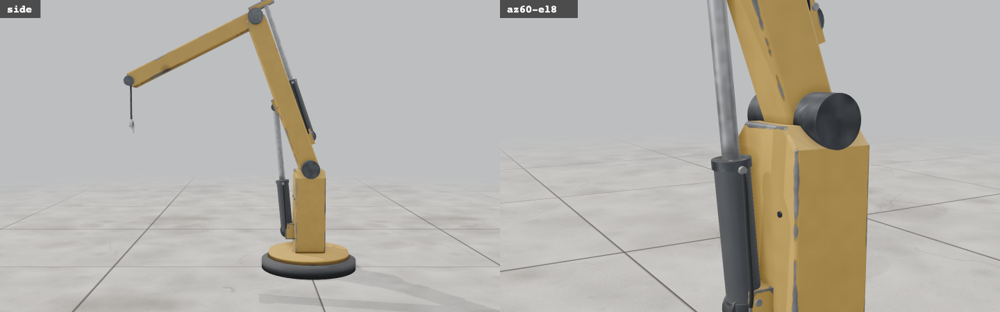
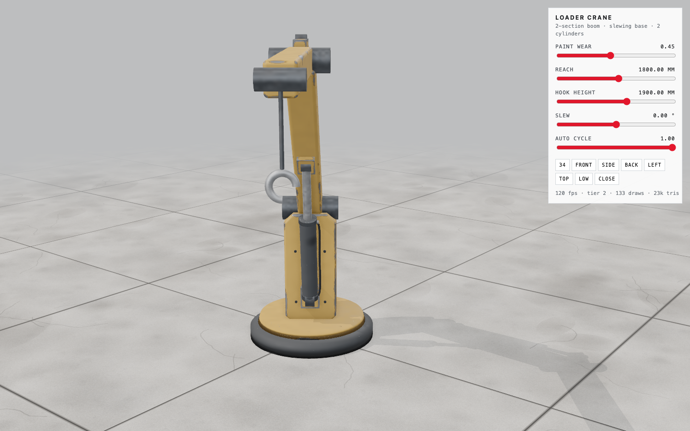
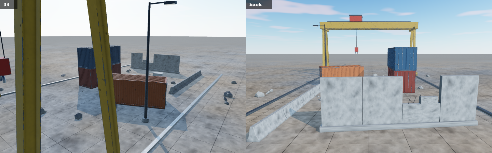

# craft3d

**A Claude Code skill for building accurate, realistic 3D models in three.js from code.** Give it a photo, a drawing, a product, or just an idea, and it builds the object at real dimensions, with joints that move by real kinematics and worn, damaged metal generated in a shader (no textures). Then it **measures and photographs its own work** before calling it done.


<sub>The starter model in the viewer: front, side, 3/4, then the same close-up at factory, worn and battle-damaged paint.</sub>

---

## Why it's accurate

Most AI-generated 3D comes out generic because it's built from a vague picture of the thing. craft3d makes Claude work like an engineer:

1. **Evidence first.** It uses your reference image or real specs, and measures the image in pixels against a known size.
2. **A dimension sheet in millimetres.** Every number is written down with where it came from.
3. **Real joints.** Every moving part pivots where the real joint is.
4. **Motion from equations, not keyframes.** It uses IK, linkages and no-slip ground contact, so the pose, the numbers and the motion always agree.
5. **Parts built the way they're manufactured.** Plate is cut and chamfered, castings are rounded, shafts are turned, structure is beams. Nothing has a razor edge.
6. **Realistic wear.** Chipped edges, rust under the chips, streaks, grime, soot and impact dents all sit where real wear happens.
7. **Proof.** Automatic checks catch floating parts, cylinders mounted on nothing, rods pulling out of their barrels and feet that slide. Then it takes screenshots from every side and compares them with the reference.

The checks find real mistakes. While the skill was being built, they caught a hydraulic cylinder pinned 70 mm from any metal:

| Before: the cylinder base floats in front of the post | After: a mounting bracket, check passes |
|---|---|
|  |  |

---

## Install

Requirements: [Claude Code](https://claude.com/claude-code), Node.js 18+ and Git.

```bash
git clone https://github.com/yesith0106/craft3d.git ~/.claude/skills/craft3d
cd ~/.claude/skills/craft3d
npm run setup        # installs Playwright + Chromium for the screenshot/measure tool
```

Restart Claude Code. The skill appears as `craft3d`. Claude uses it on its own when you ask for a realistic 3D model, or you can call it with `/craft3d`.

To update later, run `git -C ~/.claude/skills/craft3d pull`.

---

## Using it

### 1. Recreate something real

Attach a reference image, or name the object:

> Recreate this excavator in three.js [image]. Make it accurate to the photo, with working boom, stick and bucket cylinders.

> /craft3d Build a CAT 320 excavator at real dimensions with a slider for each hydraulic joint.

> Recreate this robot [image]. Keep the materials ultra realistic: metal and damaged metal.

Claude collects the specs, measures your image (mm per pixel from a known size), lists every feature it sees, and builds view by view. It matches the camera to your photo for a side-by-side comparison. At the end it tells you what was matched from evidence, what was measured from the image, and what it had to infer.

### 2. Create something from an idea

> /craft3d Design a salvage mech for a desert scrapyard, about 3 m tall, diesel-hydraulic, old and patched up.

> Make a heavy cargo lifter for a sci-fi port: forklift-style mast, four legs, industrial white with red warning lights.

Claude writes a five-line brief (job, size, power, world, look) and borrows proportions from real machines that do the same job, such as excavator cylinders for a mech's legs or forklift masts for a lifter. It blocks out the masses at full size, then adds detail. It still has to pass the same checks, so the result reads as a machine someone could build.

### 3. Use it in your own project

Every model drops into any three.js app: a game, a website, a configurator. Ask for that directly:

> Take the model and put it in a third-person game where I can walk it around with WASD.

### Tips for better results

- **More views beat one perfect photo.** Front, side and back let it measure instead of guess.
- **Give a size if you know it** ("about 2.7 m tall", "a 20 ft container"). One real number sets the scale for everything.
- **Say what should move** ("boom, stick and bucket", "legs walk, arms swing"). That decides which joints get kinematics.
- **Ask to see the tests.** It saves labelled screenshots and the measured numbers, and can show you both.

---

## Doing it by hand

You don't need Claude to use the parts. Start a project:

```bash
node ~/.claude/skills/craft3d/tools/new.mjs ./my-model
cd my-model
npm run dev          # open the URL it prints
```



The viewer gives you:
- an orbit camera
- standard views: front, side, back, left, top, 3/4, low and close
- a paint wear slider (keys `1` / `2` / `3` = factory / worn / battle)
- a slider for every input your model declares
- frame rate and draw call stats
- `H` to hide the panel

Add `?stage=outdoor` to the URL for sky, haze and sun.

Edit `src/model/model.js`. The starter is a hydraulic loader crane that shows the whole pattern in one file. A model exports `info` and `build()`:

```js
export const info = {name: 'My machine', description: '...', stage: 'studio'};

export function build({stage, THREE}) {
  const root = new THREE.Group();
  root.scale.setScalar(0.001);          // build in millimetres, display in metres
  // ... parts, pivots, materials ...
  return {
    root,
    params: [{key: 'reach', min: 600, max: 2900, value: 1800, unit: 'mm'}],   // become sliders
    update(dt, t, p) { /* pose everything from p.reach */ },
    focus: [0.8, 1.2, 0.6], radius: 1.6,   // camera framing
    struts: struts.list,                   // lets the mount check test your cylinders
    probe() { return {/* numbers to verify */}; },
  };
}
```

### The library (`src/craft/`)

| File | What's in it |
|---|---|
| `shapes.js` | `box`, rounded box `rb`, `cylX/Y/Z`, `slab` (extruded polygon), `chamferBox`, `frameGeo`, `lathe`, `ibeam`, `tube`, `boltHead`, `rock`, seeded `rng`, and `kit()` for placing parts consistently |
| `wear.js` | `makeWorn({color, rough, painted, bare, seed, dent})` for worn paint or bare metal; `bakeRest(root)`; the global `WEAR.uDamage` (0 to 1) |
| `rig.js` | `twoLinkIK`, `onSeg`, `lineArm` (actuator lever arms), `strideFor` (no-slip walking), `smoother`, `damp`, and `makeStruts` (hydraulic cylinders aimed between moving parts, with hoses) |
| `props.js` | Real-size props: 20 ft container, 200 l drum, jersey barrier, crate, 9 m light pole, broken wall, gantry crane, rubble, plus ground colliders and `collide()` |
| `stage.js` | `createStage({canvas, mode: 'studio' \| 'outdoor'})`: lighting, sun shadows that follow a target, ground, ambient occlusion, quality tiers |
| `textures.js` | Procedural concrete and ground variation |
| `checks.js` | `floatingParts`, `anchorGaps`, `overlaps` |


<sub>`?stage=outdoor` with the props library: containers, gantry crane, barriers, drums, light pole, broken wall, rubble.</sub>

### Testing a model

The page exposes `window.VIEW`, so the test tool can drive it:

```bash
node ~/.claude/skills/craft3d/tools/shoot.mjs --project ./my-model --out ./shots --query hud=0 --plan '[
  {"sample": {"expr": "VIEW.check()", "frames": 1, "label": "check"}},
  {"views": ["front", "side", "back", "34", "close"]},
  {"damage": 0.92, "wait": 300, "shot": "battle"},
  {"eval": "VIEW.set(\"reach\", 2900)", "wait": 400, "sample": {"expr": "VIEW.probe()", "frames": 240, "label": "motion"}}
]'
```

It starts the dev server, runs the plan on your real GPU, and writes:
- every screenshot, plus `sheet.png` with all of them tiled and labelled
- one JSON file per `sample`
- a printout of the GPU, frame rate, draw calls and every console error

Plan steps:

| Step | Does |
|---|---|
| `{"views": ["front", {"az": 40, "el": 10, "d": 2}]}` | Sets each camera view and screenshots it |
| `{"shot": "name"}` | Takes a screenshot |
| `{"eval": "..."}` | Runs code in the page |
| `{"down": ["KeyW"]}` / `{"up": [...]}` | Holds or releases keys, for interactive builds |
| `{"wait": 800}` | Waits, in milliseconds |
| `{"damage": 0.92}` | Sets paint wear |
| `{"sample": {"expr": "VIEW.probe()", "frames": 120, "label": "x"}}` | Records a value every frame to JSON |

A model passes when:
- `VIEW.check()` returns `{"floating": [], "anchors": []}` at rest and at the extremes of every input
- its own `probe()` invariants hold through the motion
- the screenshots match the reference

---

## What's inside the skill

```
SKILL.md                 the instructions Claude follows
references/
  recreate.md            matching a photo or a real object
  from-idea.md           designing from a brief
  accuracy.md            dimension sheets, kinematics, probes
  modeling.md            part trees, which shape for which part, detail rules
  materials.md           material values, the wear shader, lighting
  pitfalls.md            bugs that were hit, and their fixes
lib/                     the library (copied into each project as src/craft/)
template/                the viewer project
tools/new.mjs            scaffold a project
tools/shoot.mjs          screenshot + measure + contact sheet
docs/                    images for this guide
```

## Troubleshooting

- **Blank page from `dist/index.html`.** Built pages use ES modules and must be served (`npm run preview`), not double-clicked.
- **`shoot.mjs` can't find Chromium.** Run `npm run setup` in the skill folder, or set `CHROMIUM=/path/to/chrome`.
- **The tool warns "software renderer".** The headless browser didn't get your GPU, so frame rates aren't representative. Run it on a machine with a GPU or desktop session.
- **Low frame rate.** The viewer steps down automatically (no ambient occlusion, then lower resolution). Check the `draws` count, and merge static geometry if it's over about 500.

## License

MIT. See [LICENSE](LICENSE).
